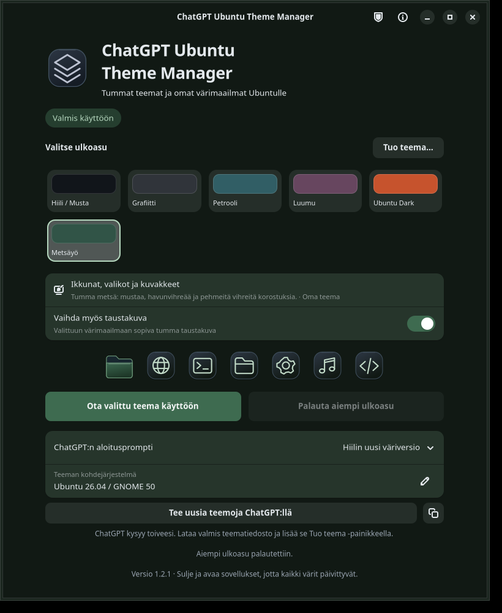

# ChatGPT Ubuntu Theme Manager

Tumma teemanhallinta Ubuntu/GNOME-työpöydälle. Vaihda viiden valmiin ulkoasun välillä tai tuo ChatGPT:llä suunniteltu oma väripaletti samaan valikoimaan. Uudelle teemalle ei synny erillistä sovelluskuvaketta.

**[Lataa asennuspaketti ja esimerkkiteema uusimmasta julkaisusta](https://github.com/Jakke77/chatgpt-ubuntu-theme-manager/releases/latest)** · **[Lataa version 1.2.1 asentaja (.deb)](https://github.com/Jakke77/chatgpt-ubuntu-theme-manager/releases/download/v1.2.1/chatgpt-ubuntu-theme-manager_1.2.1_all.deb)**

## Julkaistu sellaisenaan — käyttö omalla vastuulla

Tämä ohjelma jaetaan muiden kokeiltavaksi ja muokattavaksi. **Käytät sitä omalla vastuullasi nyt ja tulevaisuudessa.** Ohjelmalle ei luvata jatkuvaa ylläpitoa, henkilökohtaista tukea, virhekorjauksia tai yhteensopivuutta tulevien Ubuntu-, GNOME- tai sovellusversioiden kanssa. Julkinen lähdekoodi ja ladattava julkaisu eivät tarkoita ylläpitopalvelua.

Ohjelma jaetaan ilman takuuta [GPL 3 tai uudempi -lisenssin](LICENSE) ehtojen mukaisesti. Voit haarauttaa projektin eli tehdä siitä oman forkin ja jatkaa kehitystä lisenssin ehdoilla. Katso myös [tukikäytäntö](SUPPORT.md).

Tämä on epävirallinen yhteisöprojekti, ei OpenAI:n tai Canonicalin tuote.



*Kuva eristetystä testistä. Kohdejärjestelmän kentässä on esimerkkipyyntö toiselle Ubuntu-versiolle.*

## Mitä ohjelma tekee?

- Viisi valmista tummaa ulkoasua: **Hiili / Musta**, **Grafiitti**, **Petrooli**, **Luumu** ja **Ubuntu Dark**.
- Ikkunoiden, GTK 3:n, GTK 4:n, GNOME Shellin, kuvakkeiden ja haluttaessa taustakuvan väritys Hiili- ja paikallisten Yaru-pohjien avulla.
- Omien tummien väripalettien tuonti `.ctm-theme.zip`- tai `.json`-tiedostosta managerin samaan teemavalikoimaan.
- Esikatselu ennen käyttöönottoa sekä ensimmäistä käyttöönottoa edeltäneen ulkoasun palautus.
- Valmiit ChatGPT-promptit, jotka kysyvät ensin käyttäjän toiveet ja pyytävät lopuksi managerin ymmärtämää teematiedostoa.
- Muokattava Ubuntu/GNOME-kohdejärjestelmä promptia varten.
- Paikallinen yleiskäyttöön sopiva sisältörajaus teemapakettien metatiedoille ja vastaava rajaus ChatGPT-promptissa. Katso [mitä tarkistetaan ja mitkä ovat rajat](CONTENT_POLICY.md).

**Codexia tai OpenAI API -avainta ei tarvita.** ChatGPT avataan tavallisessa selaimessa. Käyttäjä tarkistaa ja lähettää promptin itse; manageri ei lähetä viestiä keskusteluun automaattisesti. Prompti kopioidaan myös leikepöydälle.

## Yhteensopivuus

| Ympäristö | Yhteensopivuuden rajaus |
| --- | --- |
| **Ubuntu 26.10 / GNOME 51** | Projektin testiympäristö. Version 1.2.0 teemojen vaihto, tuonti ja palautus tarkistettiin erillisillä testiasetuksilla tällä järjestelmällä. Uusimman julkaisun tarkistukset ovat julkaisutiedoissa. |
| **Ubuntu 26.04 / GNOME** | Kirjastoversiot täyttävät paketin vaatimukset. Käytännön toimintaa tällä Ubuntu-versiolla ei ole testattu. |
| **Ubuntu 24.04** | Nykyinen asennuspaketti ei ole yhteensopiva. Vanhempi GTK/libadwaita tarvitsee erillisen sovituksen. |
| **Kubuntu, Xubuntu ja muut työpöytäympäristöt** | Eivät ole tämän toteutuksen kohdeympäristöjä. |

Paketti vaatii **GTK 4 ≥ 4.18**, **libadwaita ≥ 1.6**, Python 3:n ja GI-sidonnat sekä Ubuntu Yarun GTK-, GNOME Shell- ja kuvakepaketit, GNOME Shellin laajennukset ja dconf-taustan. Asennuspaketti ilmoittaa nämä riippuvuudet pakettienhallinnalle.

Kohdejärjestelmän tekstikentän tai teeman `target`-kentän vaihtaminen auttaa suunnittelussa; se ei itsessään lisää manageriin tukea toiselle käyttöjärjestelmälle. Kaikki sovellukset eivät noudata työpöydän teemaa, ja eristetyt sovellukset voivat näyttää osan omista väreistään. GDM-kirjautumisruutua ei muokata.

## Asenna tai päivitä

1. Lataa [uusimman julkaisun](https://github.com/Jakke77/chatgpt-ubuntu-theme-manager/releases/latest) `.deb`-asennuspaketti.
2. Sulje aiemmin avoinna oleva Hiili- tai Theme Manager -ikkuna.
3. Avaa ladattu paketti kaksoisnapsauttamalla. Valitse paketin asennusohjelmassa **Asenna** tai **Päivitä** ja anna pyydetty salasana.
4. Avaa sovellusvalikosta **ChatGPT Ubuntu Theme Manager**.

Vaihtoehtoisesti aja komento hakemistossa, johon version 1.2.1 paketti on ladattu:

```bash
sudo apt install ./chatgpt-ubuntu-theme-manager_1.2.1_all.deb
```

Ensimmäinen asennus yrittää ottaa Hiili-ulkoasun käyttöön aktiiviselle paikalliselle työpöytäkäyttäjälle. Teeman voi ottaa käyttöön myös managerin painikkeella. **Päivitys säilyttää nykyisen ulkoasun ja alkuperäisen palautuskopion.**

Tekninen Debian-paketin nimi on edelleen `hiili-theme`, jotta aiempi Hiili 1.0 tai manageri 1.1/1.2 päivittyy samana pakettina. Sovellusvalikossa näkyy nykyinen nimi.

## Vaihda teemaa

Valitse teemakortti. Valinta näyttää esikatselun managerissa. Paina sitten **Ota valittu teema käyttöön**, jolloin työpöydän värit ja kuvakkeet vaihtuvat. **Vaihda myös taustakuva** ottaa samalla käyttöön paletin mukaan väritetyn Hiili-taustakuvan.

Sulje ja avaa jo käynnissä olevat sovellukset tarvittaessa, jotta niiden värit päivittyvät.

## Kokeile oman teeman tuontia

1. Lataa julkaisusta [Metsayo.ctm-theme.zip](https://github.com/Jakke77/chatgpt-ubuntu-theme-manager/releases/download/v1.2.1/Metsayo.ctm-theme.zip) tai [Metsayo.theme.json](https://github.com/Jakke77/chatgpt-ubuntu-theme-manager/releases/download/v1.2.1/Metsayo.theme.json).
2. Paina managerissa **Tuo teema…** ja valitse ladattu tiedosto.
3. **Metsäyö** ilmestyy teemavalikoimaan ja sen esikatselu avautuu.
4. Paina **Ota valittu teema käyttöön**.

ZIP ja JSON sisältävät saman esimerkin, joten tuo niistä vain toinen. Tuonti on käyttäjäkohtainen, ei tarvitse järjestelmänvalvojan salasanaa ja on käytettävissä myös seuraavilla käynnistyksillä. Sama `id` ei korvaa aiempaa teemaa; käytä uudelle versiolle uutta tunnistetta, esimerkiksi `metsayo-v2`.

Version 1 teemapaketti sisältää **tumman väripaletin ja teeman tiedot**. Manageri muodostaa värit omien pohjiensa avulla. Tässä pakettimuodossa ei voi tuoda vapaata CSS:ää, uusia kuvakepiirroksia, omia taustakuvatiedostoja tai vaaleaa teemaa. Paketissa ei ole asennuskomentoja tai erillistä sovellusta. Tiedostomuoto on kuvattu [teemapaketin ohjeessa](THEME_FORMAT.fi.md).

Versiosta 1.2.1 alkaen manageri tarkistaa myös kuuden tekstikentän sisällön paikallisilla säännöillä. URL-osoitteet ja merkkauskieli hylätään. Tunnistettu huijauksiin, identiteettivarkauteen tai harhaanjohtavaan toisena esiintymiseen, hyväksikäyttöön, pornografiaan, vihasisältöön tai raakaan väkivaltaan liittyvä metatieto estää tuonnin ja käyttöönoton. Tavalliset synkät ja goottilaiset tyylit sekä omaa identiteettiä ilmaisevat värit pysyvät sallittuina. Tarkistus on rajallinen: se voi erehtyä molempiin suuntiin eikä takaa teeman lainmukaisuutta. [Sisältörajaus ja esimerkit](CONTENT_POLICY.md).

Samat tarkistukset koskevat myös aiemmin tuotuja paletteja. Hylätty vanha paletti jää pois omien teemojen valikoimasta, mutta sen tiedostoja ei poisteta. **Palauta aiempi ulkoasu** on edelleen käytettävissä.

## Suunnittele paletti ChatGPT:llä

1. Valitse **ChatGPT:n aloitusprompti**: uusi oma teema, Hiilin väriversio tai oma Ubuntu Dark.
2. Tarkista **Teeman kohdejärjestelmä**. Kenttä täyttyy paikallisesta Ubuntu- ja GNOME-versiosta, mutta voit kirjoittaa toisen kohteen.
3. Paina **Tee uusia teemoja ChatGPT:llä**. Selain avautuu ja prompti kopioidaan leikepöydälle. Jos teksti puuttuu keskustelun kentästä, liitä se **Ctrl+V** ja lähetä itse.
4. Vastaa ChatGPT:n aloituskysymyksiin ja tallenna lopuksi saamasi `.ctm-theme.zip`- tai `.json`-tiedosto.
5. Tuo tiedosto manageriin **Tuo teema…** -painikkeella ja ota se käyttöön.

Kopiointipainike kopioi promptin avaamatta selainta. Jos ChatGPT ei pysty antamaan ladattavaa tiedostoa, tallenna sen tuottama kokonainen JSON tekstieditorilla `.json`-tiedostoksi. Manageri tarkistaa tiedostomuodon, paletin kontrastirajat ja metatietojen paikalliset sisältösäännöt tuonnissa. Prompti pyytää yleiskäyttöön sopivaa teemaa; manageri ei hallitse erillistä ChatGPT-keskustelua tai sen myöhempiä vastauksia.

Selaimelle valmistellaan prompti ja kohdeympäristön julkinen versiotieto. Paikallisia tiedostoja tai palautuskopioita ei liitetä keskusteluun. Aiemmalla promptilla tehtyä erillistä `.deb`-teemasovellusta ei voi tuoda suoraan; sen väripaletti on ensin muunnettava tähän teemapakettimuotoon.

## Palauta aiempi ulkoasu tai poista ohjelma

Paina **Palauta aiempi ulkoasu** ennen ohjelman poistamista. Palautuspiste sisältää ensimmäistä käyttöönottoa edeltäneet asetukset; teemojen vaihtelu ja palettien tuonti eivät korvaa sitä. Myös Hiili 1.0:n ja managerin 1.1:n palautuskopiot säilyvät yhteensopivina.

Palautuskopio on käyttäjäkohtaisesti `~/.config/hiili-theme/`-hakemistossa. Palautuksessa huomioidaan käyttäjän myöhemmät asetustiedostomuutokset ja säilytetään muut GNOME-laajennukset.

Poista ohjelma pakettienhallinnasta tai komennolla:

```bash
sudo apt remove hiili-theme
```

## Komentorivi

Aja käyttöönotto ja palautus tavallisena työpöytäkäyttäjänä:

```bash
chatgpt-ubuntu-theme-manager --import-theme Metsayo.ctm-theme.zip
chatgpt-ubuntu-theme-manager --list-themes
chatgpt-ubuntu-theme-manager --apply --variant user:metsayo
chatgpt-ubuntu-theme-manager --restore
chatgpt-ubuntu-theme-manager --print-prompt new --prompt-target 'Ubuntu 26.04 / GNOME'
```

`--no-wallpaper` jättää taustakuvan vaihtamatta, kun se annetaan `--apply`-komennon yhteydessä. Vanha `hiili-theme`-komentonimi toimii edelleen.

## Lähdekoodi, rakentaminen ja tarkistukset

Lähdekoodi on tässä repositoriossa ja [julkaisun lähdearkistossa](https://github.com/Jakke77/chatgpt-ubuntu-theme-manager/releases/tag/v1.2.1). Rakenna kohdeympäristössä:

```bash
python3 build.py
```

Valmis `.deb` syntyy `dist/`-hakemistoon. Rakennus tarvitsee Pythonin lisäksi `dpkg-deb`-, `gtk-update-icon-cache`- ja `desktop-file-validate`-työkalut. Rakentaminen ei asenna pakettia. Rakennusriippuvuudet ja testien ajamisjärjestys ovat tiedostossa [TESTING.md](TESTING.md).

Versiota 1.2.0 on tarkistettu Ubuntu 26.10 / GNOME 51 -järjestelmässä: teemapaketin validointitestit, viiden valmiin teeman ja tuodun paletin käyttöönotto ja palautus, GTK 3/GTK 4/Shell-tyylien jäsennys sekä erillisen Xvfb/dconf-istunnon graafinen kokeilu. Testiasetukset pidettiin erillään varsinaisesta työpöydästä. Tiedostovalitsin ja selaimen avaus korvattiin graafisessa testissä hallituilla vastauksilla, eikä viestiä lähetetty ChatGPT-keskusteluun. Rakennetun paketin asennuskoukut ja sisältö tarkistettiin; tämän julkaisun `.deb`-asennusta järjestelmänvalvojana tai muita Ubuntu-versioita ei kokeiltu julkaisun valmistelussa.

Version 1.2.1 muutokset ja sen tarkistusten rajaus kuvataan [julkaisutiedoissa](RELEASE_NOTES.md). Paikallinen sisältötarkistus ei käytä verkkopalvelua, API-avainta tai maksullista moderointia eikä lisää telemetriaa.

## Lisenssit

Ohjelma ja sen omat pohjat: **GPL-3.0-or-later**, katso [LICENSE](LICENSE). Metsäyö-esimerkkipaletti: **CC0-1.0**. Oman paletin tekijä ja lisenssi ilmoitetaan sen JSON-tiedoissa. Paikallisista Ubuntu-paketeista luettavat [Yarun](https://github.com/ubuntu/yaru) pohjat säilyttävät omat lisenssinsä.

## English overview

An unofficial dark theme manager for Ubuntu/GNOME. Choose one of five bundled themes, import a data-only dark color palette, apply it from the same window, and restore the previous appearance. ChatGPT prompts help create compatible palette files; no Codex installation or OpenAI API key is required.

Version 1.2.1 adds general-audience prompt boundaries and local plain-text metadata checks against recognized patterns of fraud, deceptive impersonation, exploitation, pornography, hate and graphic violence. This is a limited deterministic filter, not a universal classifier or legal-compliance guarantee. No network moderation, API key or telemetry is used. See [CONTENT_POLICY.md](CONTENT_POLICY.md) for examples, limitations and the effect on previously imported palettes.

Version 1.2.0 was tested on Ubuntu 26.10 / GNOME 51 with isolated desktop settings; see [release notes](RELEASE_NOTES.md) for this update's checks. Ubuntu 26.04 meets the library requirements but has not been tested; Ubuntu 24.04 is not supported by this package. Download the `.deb` from [Releases](https://github.com/Jakke77/chatgpt-ubuntu-theme-manager/releases/latest). The technical package name is `hiili-theme` for upgrade compatibility.

**Provided as is, without warranty under GPL-3.0-or-later. Use at your own risk. No ongoing maintenance, support, bug fixes or future compatibility is promised.** You are welcome to fork and maintain your own version under the license terms. See [SUPPORT.md](SUPPORT.md).
